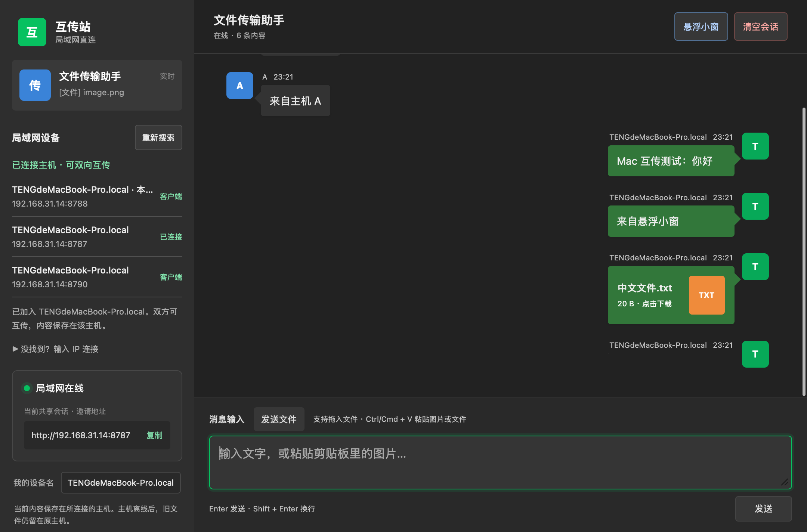
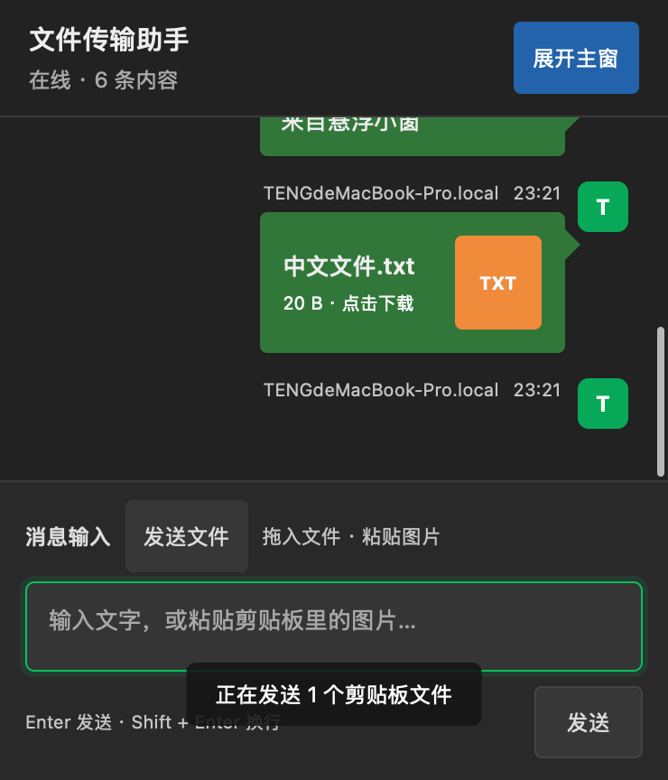
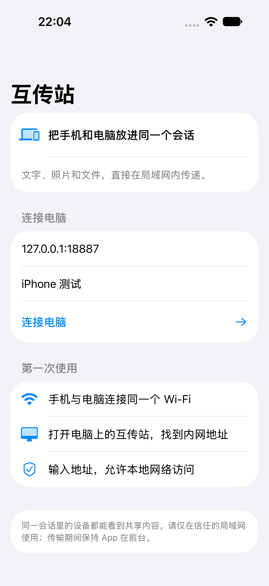
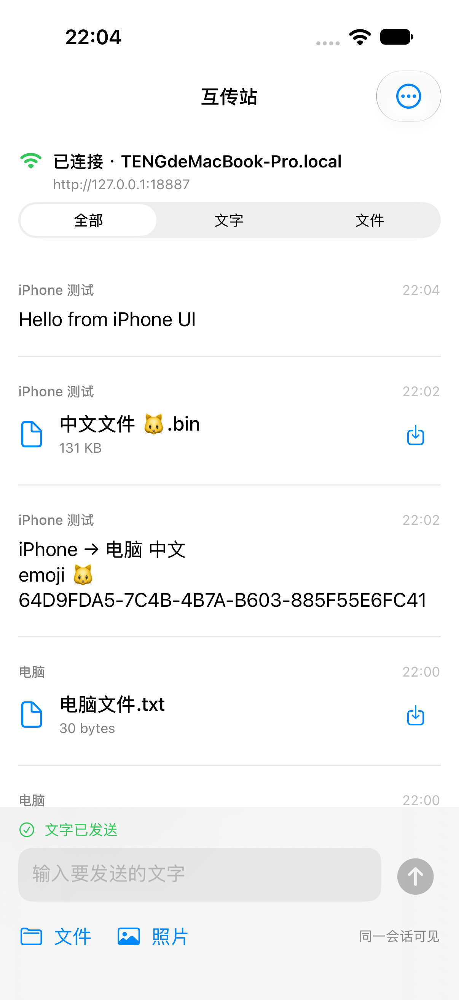
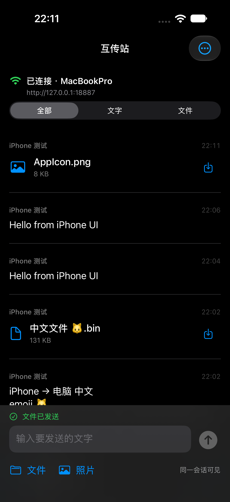
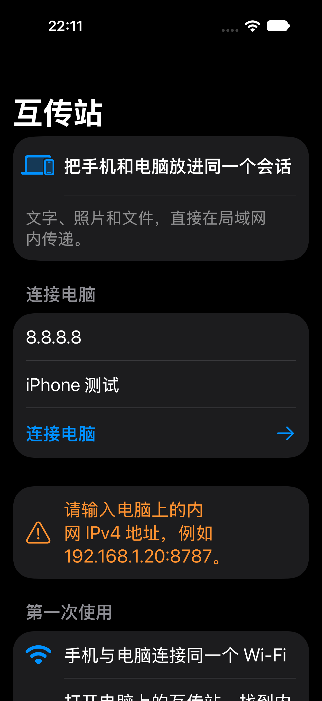

# 互传台源码

提供 Mac、Windows、iPhone 三端源码包，下载后解压查看各端的使用与构建说明。

| 平台 | 源码包 |
| --- | --- |
| Mac | [下载源码](TransferStation-Mac-Source.zip) |
| Windows | [下载源码](TransferStation-Windows-Source.zip) |
| iPhone | [下载源码](TransferStation-iPhone-Source.zip) |

## 功能

在同一局域网内互传文字、照片和文件。Mac 版支持后台常驻与悬浮组件；iPhone 版连接电脑会话，需要电脑保持开启。

## iPhone 构建

需要 Mac、Xcode 15 或更新版本和 iOS 17 或更新版本。解压后打开 Xcode 工程，使用自己的 Apple 开发团队签名安装。源码包不是可直接安装的 App，未通过 App Store 或 TestFlight 分发。

iPhone 不提供跨 App 悬浮窗，后台不保证持续传输。现有共享会话使用 HTTP，请在信任的局域网使用。

## 验证说明

iPhone 与 Mac 的连接、发送和接收已由用户真机确认；Windows 兼容性通过原版服务代码的协议测试，尚未进行 Windows 实机验证。更多记录见 iPhone 源码包中的 VALIDATION.md。

## 界面截图

### Mac 主窗口

### Mac 悬浮组件

### iPhone

以下为模拟器截图，展示连接、会话、照片发送和大字体错误提示。

